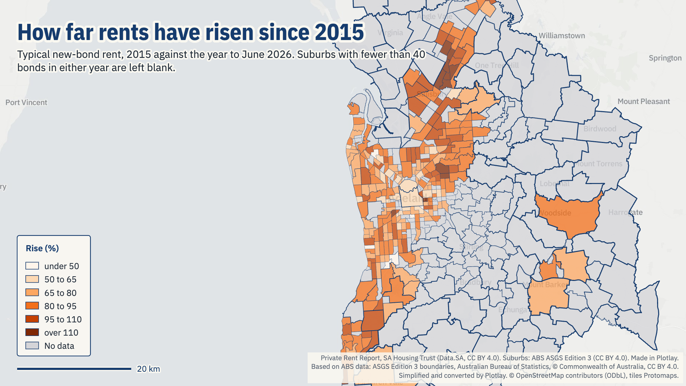
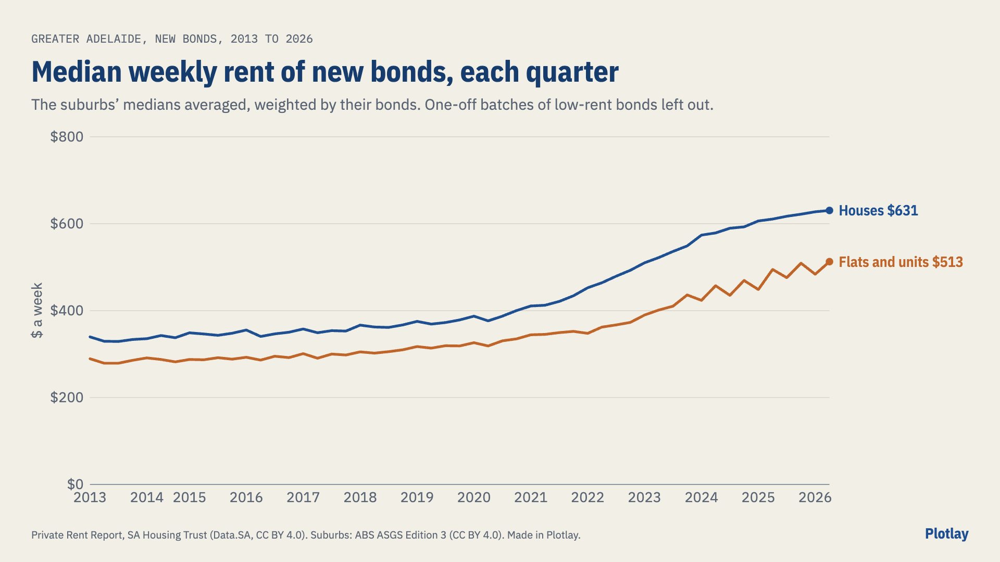

# How far have Adelaide rents risen, suburb by suburb?

Every Greater Adelaide suburb's median weekly rent for new leases, quarter by quarter from March 2013 to June 2026, from the SA Housing Trust's Private Rent Report, and the rise since 2015. **Live version, with an interactive map:** [getplotlay.com/showcase/adelaide-rents](https://www.getplotlay.com/showcase/adelaide-rents/)



**Across Greater Adelaide, the typical weekly rent of a new lease went from about $319 in 2015 to about $569 in the year to June 2026, a rise of 78%. Houses rose 80% ($347 to $625), flats and units 72% ($288 to $496). Of the 261 suburbs with enough bonds to compare, the middle suburb rose 83% and 35 doubled or more, most of them in the north: house rents in the 8 Elizabeth suburbs rose 96% to 130%.**

The report is published as one spreadsheet per quarter, each naming suburbs by name and laid out a little differently over the years. Here 53 of them are read into one table, the names matched to the ABS's official suburbs, and [Plotlay](https://www.getplotlay.com) puts the result on one map with a slider through the quarters.

[](https://app.plotlay.io/?example=adelaide-rents&as=client)

## What the data says

| Greater Adelaide | 2015 | Year to June 2026 | Rise |
|---|---|---|---|
| All dwellings | $319 | $569 | 78% |
| Houses | $347 | $625 | 80% |
| Flats and units | $288 | $496 | 72% |

The report's own metropolitan median (its Region sheet) went from $310 in the June quarter of 2015 to $580 in the June quarter of 2026; the Greater Adelaide line here runs within about 2% of it every quarter.



Where house rents rose most (40 or more house bonds in both years):

| Suburb | 2015 | Year to June 2026 | Rise |
|---|---|---|---|
| Elizabeth | $232 | $535 | +130% |
| Elizabeth South | $215 | $475 | +121% |
| Elizabeth North | $225 | $492 | +119% |
| Elizabeth East | $232 | $509 | +119% |
| Elizabeth Downs | $235 | $500 | +113% |
| Port Willunga | $285 | $596 | +109% |
| Moana | $330 | $689 | +109% |
| Davoren Park | $239 | $498 | +108% |

Where flat and unit rents rose most (40 or more unit bonds in both years):

| Suburb | 2015 | Year to June 2026 | Rise |
|---|---|---|---|
| Bowden | $283 | $622 | +120% |
| Kent Town | $308 | $630 | +105% |
| Findon | $269 | $548 | +104% |
| Croydon Park (SA) | $245 | $492 | +101% |
| Hectorville | $270 | $540 | +100% |
| Lockleys | $266 | $528 | +98% |
| Semaphore | $260 | $511 | +97% |
| Campbelltown (SA) | $258 | $505 | +96% |

The smallest rises are where the mix of lettings moved: the City of Adelaide (51%, with many rooms let to students) and the suburbs round Flinders University (Darlington (SA) -26%, Bedford Park +21%).

### Read it carefully

- **New leases only.** A bond is lodged when a lease starts, so these are the rents asked of people moving in, not what every tenant pays. They move first.
- **The base year.** 2015: the first full calendar year after the December 2014 report (which covers six months, July to December, and is left out), and about ten years back. Each window's typical rent is the middle of its four quarterly medians, so one odd quarter cannot move it. The reports give no bond-by-bond data, so a true annual median cannot be worked out.
- **Small counts.** A quarter's median is shown only where 10 or more new bonds were lodged (25% of suburb quarters are below that). A suburb's rise is worked out only where both years have 40 or more bonds: 261 of 493 Greater Adelaide suburbs (192 for houses alone, 78 for units). The reports print counts of 1 to 5 as `*`.
- **One-off batches.** 21 suburb quarters (the largest in Mitchell Park, Elizabeth Grove and Elizabeth Vale in 2015-16, and Morphettville, Mansfield Park and Woodville Gardens in 2017-18) carry hundreds of bonds at about half the suburb's usual rent: a block of tenancies lodging at once. The report does not say whose they are. They are left out (2,450 bonds).
- **Names, not codes.** The report names suburbs. Plotlay's matcher matched 1,310 of the 1,375 spellings in 53 reports to an ABS suburb (99.95% of bonds). The rest are post office names (Adelaide GPO Private Boxes, Kent Town Delivery Centre), old or local names and typing slips, and Riverlea Park, a new suburb near Buckland Park from 2024 with no 2021 ABS area.
- **Greater Adelaide** is the ABS Greater Capital City Statistical Area. The report's own Metro flag moved in 2021 (Gawler and the Hills), so it is not used.

## How it was made with Plotlay

1. **A map project** on Plotlay's Quiet base map, and one **data layer**.
2. **Link the rent table to an empty layer.** Plotlay reads the suburb column as ABS Suburbs and Localities, matches the report's names (with the one new suburb left over, shown with its closest names) and **makes the areas**: the official boundaries, keyed by ABS code.
3. **Link by key** one row per suburb and quarter as a **time axis**, and colour by the median rent: the slider steps the 53 quarters.
4. **Colour by the rise since 2015** from the first table.
5. **Charts, map pictures and a one-page brief** on the Analysis page, each exported as PNG.
6. **Export** GeoJSON, TopoJSON for the Power BI Shape Map, CSV with WKT and the linked data.

## What's here

| Folder | What |
|---|---|
| [`data/tables/`](data/tables) | The quarterly and suburb tables, Greater Adelaide by quarter, every report row read, the name matches |
| [`data/geometry/`](data/geometry) | Greater Adelaide's suburbs from Plotlay, keyed by ABS code: GeoJSON, TopoJSON, CSV with WKT |
| [`python/`](python) | A narrated notebook that recomputes every number here: [`adelaide_rents.ipynb`](python/adelaide_rents.ipynb) |
| [`powerbi/`](powerbi) | A Power BI Project (`.pbip`). Start with [`powerbi/OPEN-ME.md`](powerbi/OPEN-ME.md) |
| [`visuals/`](visuals) | The map pictures and charts, made in Plotlay from the same layer |

### Run the notebook

```
python -m venv .venv && . .venv/bin/activate
pip install -r python/requirements.txt
jupyter notebook python/adelaide_rents.ipynb
```

## Sources and licences

- **Private Rent Report**, South Australian Housing Trust, from the Rental Bond Data Set of Consumer and Business Services: [Data.SA](https://data.sa.gov.au/data/dataset/private-rent-report), CC BY 4.0.
- **ABS ASGS Edition 3** (Suburbs and Localities, SA2, Greater Capital City Statistical Areas, 2021) and the **2021 Census** (persons and dwellings by suburb): Australian Bureau of Statistics, CC BY 4.0.
- Base map in the app: Plotlay Quiet, from OpenStreetMap data (ODbL). No data here comes from OpenStreetMap.

Our tables, shapes and visuals are CC BY 4.0 ([LICENSE-DATA](LICENSE-DATA)); the code is MIT ([LICENSE](LICENSE)). Full credits in [NOTICE](NOTICE). This is independent work using open data, not endorsed by the SA Housing Trust or the ABS.
